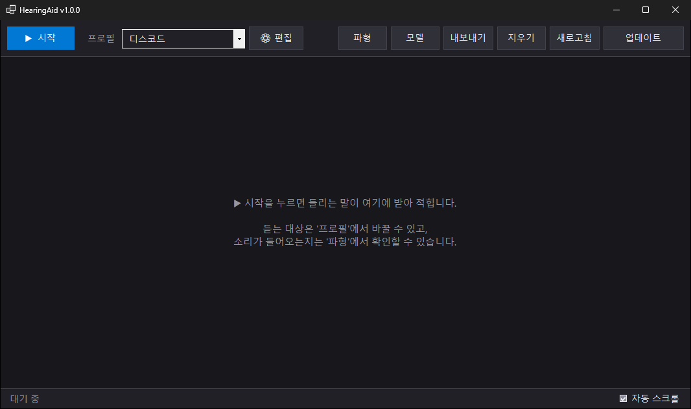
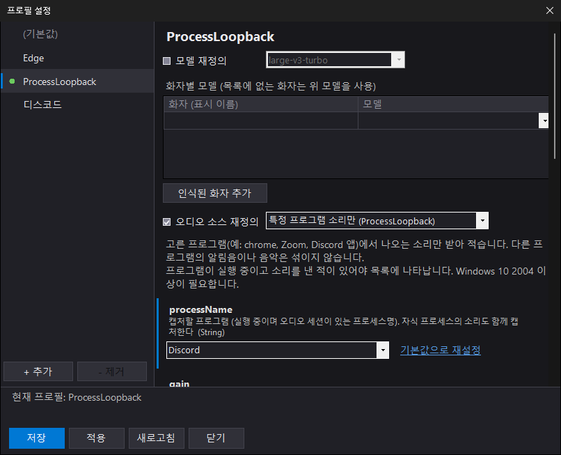
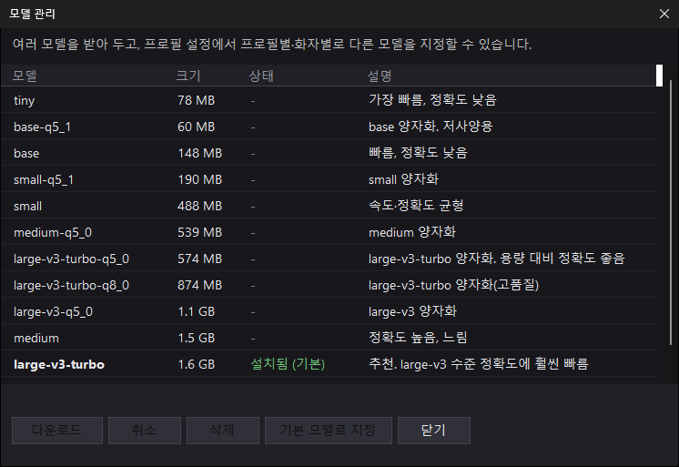

<div align="center">

# HearingAid

### *PC에서 나는 소리를 실시간으로 받아 적는 Windows 자막 앱*

[](https://github.com/Hyeseong1835/HearingAid/releases/latest)
[](https://github.com/Hyeseong1835/HearingAid/releases)
[](#-설치)
[](LICENSE)

[설치](#-설치) · [사용법](#-사용법) · [Discord 설정](docs/discord.md) · [문제 해결](#-문제-해결) · [개발](#-개발)

</div>

## 소개

유튜브, 회의, 게임, Discord 음성 채널에서 나오는 말을 **실시간 자막처럼** 글로 보여줍니다.
음성 인식은 [Whisper](https://github.com/ggerganov/whisper.cpp)로 **PC 안에서** 처리하므로 소리가 외부 서버로 전송되지 않습니다.

**🚀 빠른 시작:** [Releases](https://github.com/Hyeseong1835/HearingAid/releases/latest)에서 zip을 받아 풀고 `HearingAid.exe`를 실행하세요. 처음 실행하면 모델 다운로드 화면이 안내합니다.

<div align="center">
  
  <br><em style="font-size:80%">메인 화면</em>
</div>

## ✨ 기능

- **🔊 여러 오디오 소스**

  | 오디오 소스 | 용도 |
  |---|---|
  | PC 소리 전체 | 스피커·헤드폰으로 나오는 모든 소리 |
  | 특정 프로그램 소리만 | 고른 프로그램(chrome, Zoom 등)의 소리만. 알림음이 섞이지 않음 |
  | 마이크 등 입력 장치 | 마이크, 또는 VB-CABLE 같은 가상 오디오 케이블 |
  | Discord 음성 채널 | 봇이 음성 채널에 들어가 **말하는 사람별로** 받아 적음 → [설정 방법](docs/discord.md) |

- **🗂️ 프로필**

  오디오 소스와 설정을 프로필로 저장해 두고 클릭 한 번으로 바꿔 씁니다.
  설정마다 설명이 붙어 있어 각 값이 무엇인지 화면에서 바로 알 수 있습니다.

  <div align="center">
    
    <br><em style="font-size:80%">프로필 설정</em>
  </div>

- **🧠 모델 선택**

  가벼운 `tiny`부터 정확한 `large-v3`까지 앱 안에서 받아 둘 수 있습니다.
  **프로필별**, **화자별**로 다른 모델을 지정할 수 있습니다.

  <div align="center">
    
    <br><em style="font-size:80%">모델 관리</em>
  </div>

- **⚡ GPU 가속**

  Vulkan을 지원하는 GPU(NVIDIA·AMD·Intel)를 자동으로 사용하고, 없으면 CPU로 동작합니다.

- **🔉 자동 증폭**

  앱이나 플레이어 볼륨이 낮아 소리가 아주 작게 들어와도 자동으로 키워서 받아 적습니다.

- **🔄 자동 업데이트**

  새 버전이 나오면 실행할 때 알려 주고, 버튼 하나로 업데이트합니다. 설정·프로필·모델은 그대로 유지됩니다.

- **📄 내보내기**

  받아 적은 내용을 TXT 또는 CSV로 저장합니다.

## 📦 설치

1. [Releases](https://github.com/Hyeseong1835/HearingAid/releases/latest)에서 `HearingAid-<버전>-win-x64.zip`을 받습니다.
2. 원하는 폴더에 압축을 풀고 `HearingAid.exe`를 실행합니다.
3. 처음 실행하면 음성 인식 모델을 고르는 창이 뜹니다. 잘 모르겠다면 **추천 모델 `large-v3-turbo`** (약 1.6GB)를 받으세요.

> [!NOTE]
> 코드 서명이 없어 처음 실행할 때 "Windows의 PC 보호" 창이 뜰 수 있습니다. **추가 정보 → 실행**을 누르세요.

> [!TIP]
> 설정을 앱 폴더에 저장하므로 `C:\Program Files`처럼 쓰기가 제한된 폴더는 피하세요. 바탕 화면이나 문서 폴더면 충분합니다.

<details>
<summary><strong>시스템 요구 사항</strong></summary>
<br/>

| 항목 | 요구 사항 |
|---|---|
| OS | Windows 10 이상, 64비트 ("특정 프로그램 소리만"은 Windows 10 2004 이상) |
| .NET | 앱에 포함됨. 따로 설치하지 않아도 됨 |
| GPU | 선택. Vulkan 지원 GPU가 있으면 훨씬 빠름 |
| 디스크 | 앱 약 200MB + 모델 60MB ~ 3GB |

</details>

<details>
<summary><strong>모델 고르기</strong></summary>
<br/>

| 모델 | 크기 | 추천 상황 |
|---|---|---|
| `large-v3-turbo` | 1.6GB | **추천.** GPU가 있는 PC. 정확하고 빠름 |
| `large-v3-turbo-q5_0` | 574MB | 용량을 아끼고 싶을 때. 정확도는 거의 비슷 |
| `small`, `small-q5_1` | 190~490MB | GPU가 없거나 저사양 PC |
| `tiny`, `base` | 60~150MB | 빠른 테스트용. 정확도 낮음 |
| `large-v3` | 3.1GB | 가장 정확하지만 가장 느림 |

모델은 언제든 메인 화면의 **모델** 버튼에서 추가하거나 지울 수 있습니다.

</details>

## 🧭 사용법

| 버튼 | 하는 일 |
|---|---|
| **시작 / 정지** | 받아 적기를 시작하거나 멈춤 |
| **프로필** (목록) | 사용할 프로필을 골라 바로 전환 (캡처를 정지한 상태에서) |
| **⚙ 편집** | 프로필 추가·삭제, 오디오 소스·모델·화자별 모델 설정 |
| **모델** | 모델 다운로드·삭제, 기본 모델 지정 |
| **파형** | 들어오는 소리 크기를 실시간으로 표시. 받아 적기가 안 될 때 확인용 |
| **내보내기** | TXT / CSV로 저장 |
| **업데이트** | 새 버전 확인 및 설치 |

### 프로필 만들기

1. **⚙ 편집 → + 추가**로 프로필을 만듭니다.
2. 맨 위 **오디오 소스**에서 무엇을 들을지 고릅니다. 각 설정 아래에 설명이 표시됩니다.
3. 필요하면 **모델 재정의**나 **화자별 모델**을 지정합니다.
4. **저장 → 이 프로필 사용**을 누른 뒤 메인 화면에서 **시작**합니다.
   이후에는 메인 화면의 프로필 목록에서 바로 바꿀 수 있습니다.

처음 실행하면 프로필이 없으므로, 메인 화면의 안내에 따라 프로필을 만들고 오디오 소스를 고르세요.
오디오 소스가 정해지지 않은 프로필은 목록에 ⚠ 표시가 붙고 시작할 수 없습니다.

Discord 음성 채널을 받아 적으려면 봇을 먼저 만들어야 합니다. [Discord 설정 가이드](docs/discord.md)를 따라 하세요.

## 🔧 문제 해결

<details>
<summary><strong>소리가 나는데 아무것도 받아 적지 않아요</strong></summary>
<br/>

1. **파형** 창을 열어 소리가 들어오는지 확인하세요.
2. 파형이 일자라면 다른 오디오 소스를 고르세요. 예를 들어 헤드폰이 아닌 다른 출력 장치로 소리가 나가고 있을 수 있습니다.
3. 파형이 아주 작다면 프로필의 `autoGain`(자동 증폭)이 켜져 있는지 확인하세요. Windows 볼륨 믹서에서 해당 앱 볼륨을 올려도 됩니다.
4. 파형은 충분한데 받아 적지 않는다면 `vadThreshold`를 낮춰 보세요(예: 0.5).

</details>

<details>
<summary><strong>말하지 않았는데 엉뚱한 문장이 나와요</strong></summary>
<br/>

조용한 곳의 마이크처럼 잡음이 있으면 자동 증폭이 잡음까지 키울 수 있습니다.
해당 프로필에서 `autoGain`을 끄거나 `vadThreshold`를 올려 보세요(예: 0.8).

</details>

<details>
<summary><strong>받아 적기가 너무 느려요</strong></summary>
<br/>

GPU가 없으면 큰 모델은 느립니다. **모델** 화면에서 `small`이나 이름에 `q5`가 붙은 양자화 모델을 받아 기본 모델로 지정하세요.

</details>

<details>
<summary><strong>"특정 프로그램 소리만" 목록에 프로그램이 없어요</strong></summary>
<br/>

프로그램이 실행 중이고 **한 번이라도 소리를 낸** 상태여야 목록에 나타납니다. 영상을 잠깐 재생한 뒤 다시 열어 보세요.

</details>

> [!WARNING]
> Discord 프로필의 봇 토큰은 `profiles\` 폴더에 평문으로 저장됩니다. 이 폴더를 다른 사람과 공유하지 마세요.

## 🛠️ 개발

**필요:** Windows, [.NET 10 SDK](https://dotnet.microsoft.com/download)

```powershell
git clone https://github.com/Hyeseong1835/HearingAid.git
cd HearingAid
dotnet run
```

<details>
<summary><strong>릴리스 만들기</strong></summary>
<br/>

1. `HearingAid.csproj`의 `<Version>`을 올립니다.
2. 아래 명령을 실행합니다. [gh CLI](https://cli.github.com) 로그인이 필요합니다.

   ```powershell
   .\scripts\publish.ps1 -Publish
   ```

   `release\HearingAid-<버전>-win-x64.zip`을 만들고 GitHub 릴리스 `v<버전>`을 생성합니다. `-Publish` 없이 실행하면 zip만 만듭니다.

> [!IMPORTANT]
> 앱의 업데이트 확인은 태그 `v<버전>`과 자산 이름 `HearingAid-*-win-x64.zip`에 의존합니다. 이 형식을 바꾸지 마세요.

</details>

<details>
<summary><strong>프로젝트 구조</strong></summary>
<br/>

```
src/
  Program.cs                   진입점, 첫 실행 모델 선택, 업데이트 교체 모드(--apply-update)
  Core/
    Config.cs                  appsettings.json + profiles/*.json 병합, 오디오 소스 생성(리플렉션)
    TranscriberEngine.cs       오디오 소스 → VAD → Whisper 전사, 화자별 모델 선택
    Audio/
      IAudioSource.cs          오디오 소스 인터페이스. [AudioSource]를 붙이면 설정 화면에 자동으로 나타남
      AudioChannel.cs          자동 증폭 + Silero VAD로 발화 구간을 잘라 전사로 넘김
      AudioSources/            WASAPI 루프백, 프로세스 루프백, WaveIn, Discord(NetCord)
    Stt/                       Whisper 모델 래퍼, 모델 카탈로그·다운로드(ModelStore)
    Update/                    GitHub Releases 확인·다운로드·파일 교체
  UI/WinForms/                 메인 창, 프로필 설정, 모델 관리, 업데이트, 파형
docs/                          사용 설명서
scripts/publish.ps1            릴리스 zip 생성 / GitHub 릴리스
```

새 오디오 소스는 `IAudioSource`를 구현하고 `[AudioSource("이름", DisplayName = ..., Description = ...)]`만 붙이면 됩니다.
생성자 매개변수가 그대로 설정 화면의 항목이 되고, `[Description]`은 항목 설명으로, `[PasswordPropertyText(true)]`는 가려진 입력란으로 표시됩니다.

</details>

## 🙏 감사

- [Whisper.net](https://github.com/sandrohanea/whisper.net) / [whisper.cpp](https://github.com/ggerganov/whisper.cpp) — 음성 인식
- [Silero VAD](https://github.com/snakers4/silero-vad) — 발화 구간 감지
- [NAudio](https://github.com/naudio/NAudio) — Windows 오디오 캡처
- [NetCord](https://github.com/NetCordDev/NetCord) — Discord 음성 수신
- [ONNX Runtime](https://github.com/microsoft/onnxruntime)

## 📜 라이선스

[MIT](LICENSE) © Hyeseong1835
